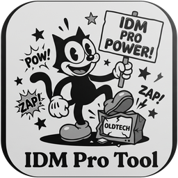

  

<h1 align="center">DTrix IDM Tool — Official Releases</h1>

  <strong>Tải về phiên bản chính thức của bộ công cụ kích hoạt và duy trì bản quyền Internet Download Manager</strong>

  
  
  
  

---

## 📦 Tải Về / Download

| Tệp tải về | Mô tả | Dung lượng |
| :--- | :--- | :--- |
| 📦 **[DTrix-IDM-v1.6.2.zip](DTrix-IDM-v1.6.2.zip)** *(Khuyên dùng)* | Trọn gói gồm file chạy `DTrix_IDM.exe` và `app_icon.png` (Giải nén ra dùng ngay) | ~290 KB |
| ⚡ **[DTrix_IDM.exe](DTrix_IDM.exe)** | File thực thi độc lập (Cần tải kèm [app_icon.png](app_icon.png) cùng thư mục) | ~290 KB |
| 🖼️ **[app_icon.png](app_icon.png)** | Biểu tượng giao diện đồ họa WPF | ~98 KB |

---

## 🇻🇳 Hướng Dẫn Sử Dụng (Tiếng Việt)

1. **Tải về:** Tải gói `DTrix-IDM-v1.6.2.zip` ở bảng trên về máy và giải nén.
2. **Thoát hoàn toàn IDM:** Nhấp chuột phải vào biểu tượng IDM ở khay hệ thống (góc dưới bên phải màn hình) -> chọn **Exit** (Thoát).
3. **Khởi chạy:** Nhấp chuột phải vào `DTrix_IDM.exe` chọn **Run as administrator** (Chạy với quyền quản trị viên).
4. **Chọn chế độ mong muốn:**
   * **Chế độ 1 (Mở khóa chuyên sâu):** Bấm `⚡ Kích Hoạt Mở Khóa Chuyên Sâu` để kích hoạt bản quyền trọn đời, triệt tiêu 100% popup báo serial giả. Hỗ trợ đầy đủ **IDM 6.43 Build 18**.
   * **Chế độ 2 (Đóng băng dùng thử vĩnh viễn):** Bấm `❄️ Đóng Băng Dùng Thử Ngay` để cố định thời hạn dùng thử ở mức 30 ngày mãi mãi. Chế độ này tương thích mọi bản cập nhật IDM chính thức trong tương lai.

---

## 🇬🇧 Quick Start Guide (English)

1. **Download:** Download `DTrix-IDM-v1.6.2.zip` from the table above and extract it.
2. **Exit IDM:** Right-click the IDM tray icon at the bottom-right corner of the taskbar and click **Exit**.
3. **Launch:** Right-click `DTrix_IDM.exe` and select **Run as administrator**.
4. **Choose your mode:**
   * **Mode 1 (Rapid Deep Unlock):** Click `⚡ Execute Rapid Deep Unlock` for permanent lifetime registration without fake serial nag screens. Fully verified on **IDM 6.43 Build 18**.
   * **Mode 2 (Permanent Trial Freeze):** Click `❄️ Freeze Evaluation Trial` to lock the evaluation period at 30 days forever. 100% compatible with future official IDM auto-updates.

---

## 🛡️ Lưu Ý Bảo Mật / Security Notice

* **100% An toàn & Offline:** Phần mềm hoạt động hoàn toàn cục bộ trên máy tính của bạn, **không có bất kỳ kết nối mạng nào** và không gửi bất kỳ dữ liệu cá nhân nào ra ngoài.
* **Cảnh báo giả (False Positive):** Vì đây là công cụ bẻ khóa/can thiệp bản quyền phần mềm, một số trình duyệt hoặc phần mềm diệt virus có thể cảnh báo là `HackTool` hoặc `RiskWare`. Đây là cơ chế bảo vệ bản quyền phần mềm thông thường, bạn có thể hoàn toàn yên tâm sử dụng.

---

## 📄 License

Distributed under the **GNU General Public License v3.0 (GPLv3)**.
